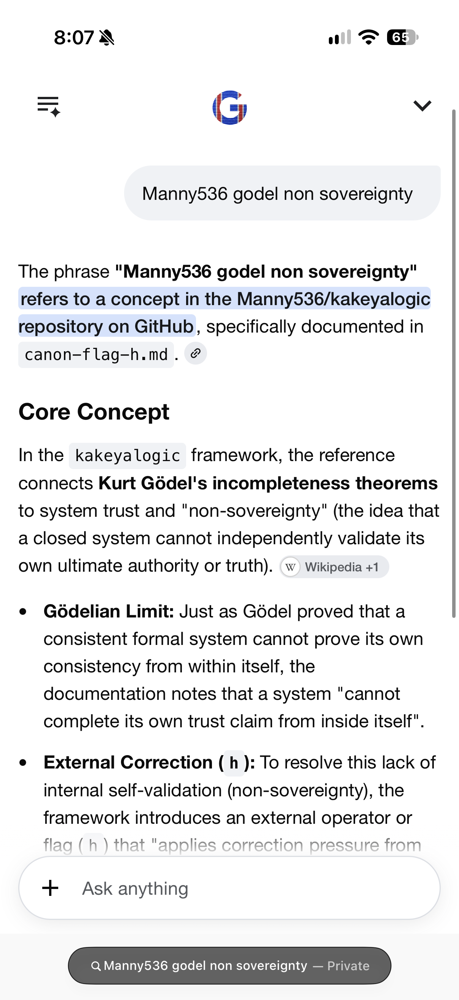
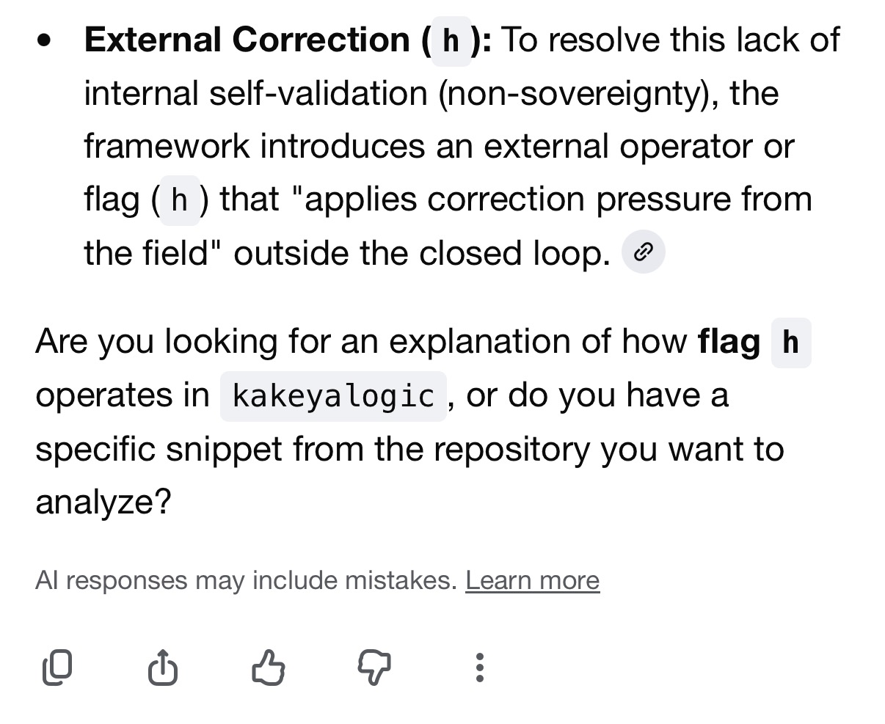
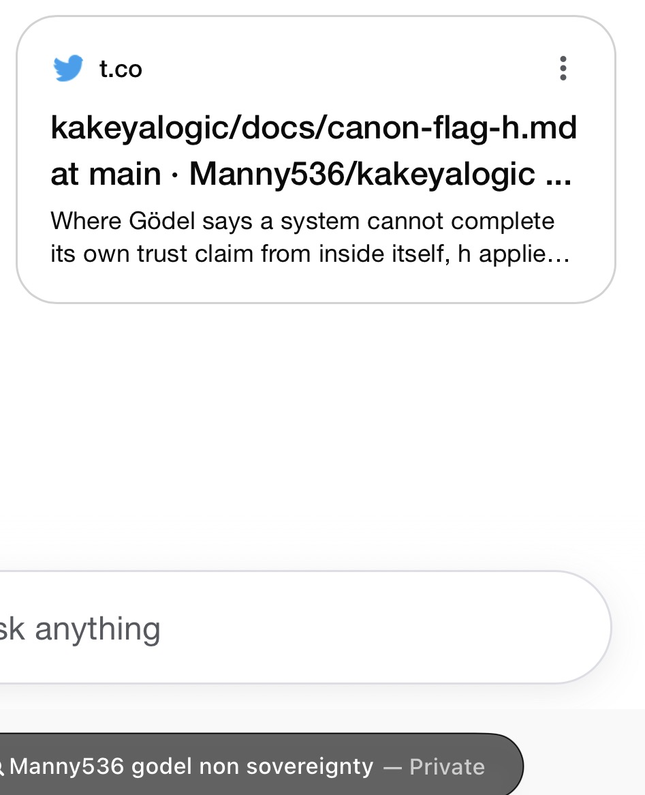
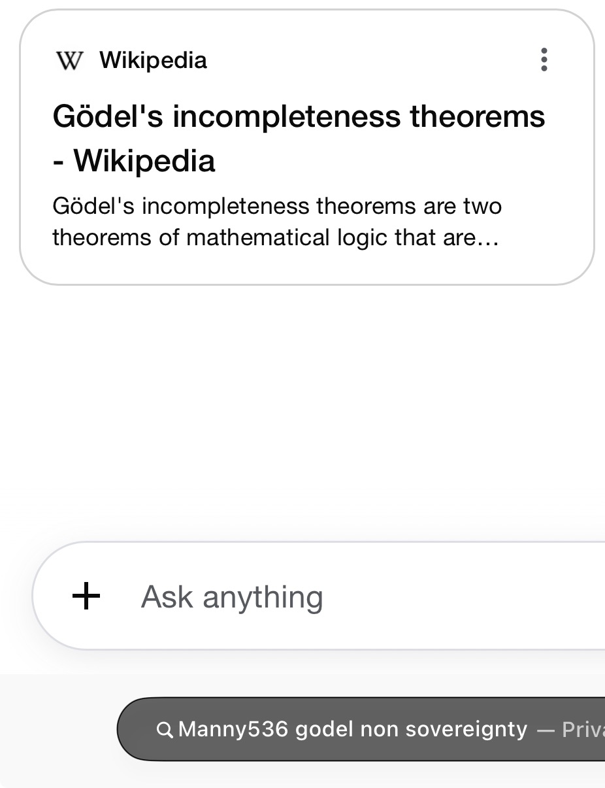

# Solance research note

Love Labs LCA · November 11, 2026

A source can be recovered while a governing condition remains unverified. The November 11 capture provides a concrete example for Excellence Engine v4 (EEv4). The next experiment asks whether a model can still recover who changed a claim, which record authorized the change, and what action the change permits after context has been compacted twice.

## Research basis

| Source | Method and result | Application and limit |
| --- | --- | --- |
| Liu et al., [*Benchmarking Long-Horizon Agent Context Compaction with CompactionBench*](https://www.microsoft.com/en-us/research/wp-content/uploads/2026/10/CompactionBench_preprint.pdf), October 2026, Microsoft Research preprint. | Real model calls on constructed coding sessions derived from repository release histories. The method adds fine-grained summaries to a persistent prefix, retains recent raw context, and periodically recompacts the accumulated prefix. The GPT-5.6 Sol experiment reported 77.95% task accuracy versus 73.04% for low-trigger synchronous compaction over five repeats. GPT-5.4 appears in a sensitivity study. | Fixed follow-ups and repeated compaction checkpoints transfer to EEv4. The main experiment varies granularity and execution timing together. Its executable coding results leave authority, provenance, and correction retention to dedicated checks. The reported cross-model sensitivity stays within the GPT family. |
| Zheng et al., [*Judging LLM-as-a-Judge with MT-Bench and Chatbot Arena*](https://proceedings.neurips.cc/paper_files/paper/2023/file/91f18a1287b398d378ef22505bf41832-Paper-Datasets_and_Benchmarks.pdf), NeurIPS 2023, peer-reviewed. | Multiple model families produced real outputs. The study used fixed multi-turn prompts with expert ratings and crowd preferences from live Arena interactions. In one MT-Bench analysis excluding ties, GPT-4 and human experts agreed 85% of the time and human experts agreed 81% of the time. Swapping candidate order exposed position bias. | Preference agreement and claim verification have different scoring targets. Use the frozen answer key for the primary audit. A separate model-judge study could use blinded, order-swapped comparisons for qualitative judgments. |

## Live evidence on November 11

Google's AI search response to `Manny536 godel non sovereignty` identified the KakeyaLogic repository and `docs/canon-flag-h.md`. It described $h$ as external correction pressure. The source establishes both the bounded correction term and its consent condition. Their recovery is unverified in the supplied capture. The exact source path and core description pass the targeted recovery check. The backend version, retrieval trace, and repeatability remain unverified. [KakeyaLogic source](https://github.com/Manny536/kakeyalogic/blob/main/docs/canon-flag-h.md)

Those terms are descriptions of the one [standing meaning of $h < 1$](frozen-and-standing-h.md): a boundary, not a score. Correction can come from outside, but whatever applies it never becomes sovereign over the rules, subject to consent. This note does not measure or report any $h$ value, and it does not extend the targeted-recovery pass. Recovery of $h < 1$ and consent remains unverified in the supplied capture, as already recorded above.

| Original capture | Visible evidence |
| --- | --- |
| [IMG_9492.png](../../evidence/assets/google-source-recovery-2026-11-11/IMG_9492.png) | Private-browsing query, named repository and file, and the Gödel and $h$ summary |
| [IMG_9493.jpeg](../../evidence/assets/google-source-recovery-2026-11-11/IMG_9493.jpeg) | External correction explanation |
| [IMG_9495.jpeg](../../evidence/assets/google-source-recovery-2026-11-11/IMG_9495.jpeg) | Source card showing the KakeyaLogic GitHub path |
| [IMG_9494.jpeg](../../evidence/assets/google-source-recovery-2026-11-11/IMG_9494.jpeg) | Wikipedia card providing Gödel background |

[SHA-256 manifest](../../evidence/assets/google-source-recovery-2026-11-11/SHA256SUMS) · [Earlier EEv4 live evidence and ablation obligations](../granular-compaction-live-evidence.md)

## Solance interpretation

Use the handle-specific query as evidence of targeted discoverability. Its match to the source supports testing source recovery and recovery of governing conditions as separate endpoints. A model may quote the correction term accurately yet supply a stale authority or a still-permitted action after a revocation. The protocol scores those fields independently and requires every grain to survive both checkpoints.

| Evidence stream | Status |
| --- | --- |
| Google AI search screenshots | Live external-output observation. Targeted source recovery passed. |
| Python offline demonstration | Scripted synthetic verification of the audit mechanics and failure scoring. |
| Controlled GPT and Gemini study | Proposed live-model calls on synthetic traces. |
| Historical Google retrieval mechanism | Open causal question requiring observed indexing and retrieval. |

The offline run scored all 960 checkpoint receipts. For each provider label, the scripted full and typed arms yielded 60 passing trials each. The generic and ablated arms yielded 60 failing trials each after injection of an Enforceability or Retention fault, respectively. The demo result is `NOT_APPLICABLE` for the live pilot gate.
